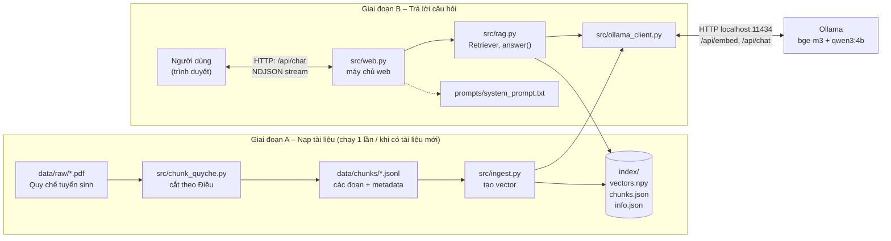
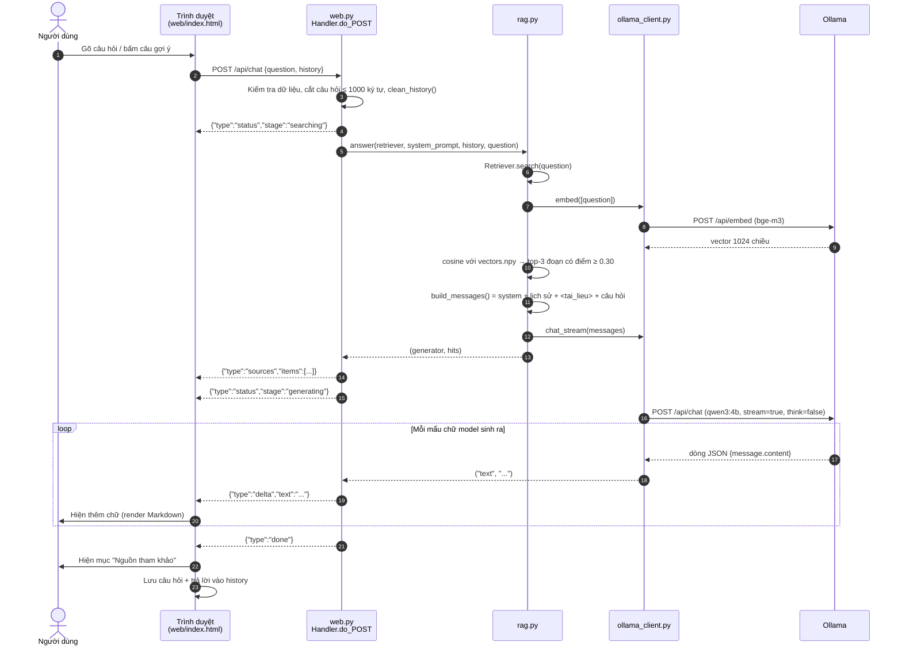

# Kiến trúc và quy trình xử lý – Trợ lý tuyển sinh

Tài liệu mô tả cách hệ thống hoạt động từ lúc nạp văn bản quy chế cho đến khi trả lời một câu hỏi trên trình duyệt:
các thành phần, luồng dữ liệu, từng hàm được gọi, và định dạng dữ liệu trao đổi giữa các thành phần.

> Mô tả theo mã nguồn hiện tại trong thư mục `src/` và `web/`. Khi sửa code, cập nhật lại các mục tương ứng.

---

## 1. Tổng quan

Trợ lý tuyển sinh là ứng dụng **chạy hoàn toàn trên máy tính cá nhân (local)**, theo hướng **RAG** (Retrieval-Augmented Generation):

1. Văn bản quy chế (PDF) được cắt thành các đoạn nhỏ theo Chương / Mục / Điều.
2. Mỗi đoạn được biến thành **vector** (dãy số biểu diễn ý nghĩa) và lưu vào thư mục `index/`.
3. Khi người dùng hỏi, hệ thống tìm vài đoạn có ý nghĩa gần câu hỏi nhất, ghép vào prompt,
   rồi để mô hình ngôn ngữ (LLM) soạn câu trả lời **chỉ dựa trên các đoạn đó**, có dẫn Điều khoản.

Mô hình **không được huấn luyện lại**. Muốn cập nhật kiến thức chỉ cần nạp thêm tài liệu và tạo lại index.

### Công nghệ sử dụng

| Thành phần | Công nghệ | Vai trò |
|---|---|---|
| Mô hình sinh câu trả lời | `qwen3:4b` chạy trên **Ollama** | Đọc tài liệu tìm được, soạn câu trả lời tiếng Việt |
| Mô hình embedding | `bge-m3` chạy trên **Ollama** | Biến văn bản thành vector 1024 chiều để tìm kiếm |
| Kho vector | File `numpy` (`index/vectors.npy`) | Lưu vector, tìm kiếm bằng độ tương đồng cosine |
| Máy chủ web | Python, thư viện chuẩn `http.server` | Nhận câu hỏi, điều phối tìm kiếm và gọi mô hình |
| Giao diện | 1 file HTML/CSS/JavaScript (`web/index.html`) | Ô chat, hiển thị câu trả lời dần dần, nguồn tham khảo |
| Đọc PDF | `pdfplumber` | Trích văn bản giữ đúng dấu tiếng Việt |

Thư viện Python cần cài: `numpy`, `requests`, `pdfplumber` (xem `requirements.txt`).
Không dùng framework web hay cơ sở dữ liệu vector bên ngoài.

---

## 2. Sơ đồ kiến trúc



Nếu nơi xem không hiển thị được sơ đồ Mermaid, có thể đọc phiên bản chữ sau:

```
NẠP TÀI LIỆU:
 PDF ──► chunk_quyche.py ──► data/chunks/*.jsonl ──► ingest.py ──(embed)──► Ollama/bge-m3
                                                          └──► index/ (vectors.npy, chunks.json, info.json)

TRẢ LỜI CÂU HỎI:
 Trình duyệt ──POST /api/chat──► web.py ──► rag.answer()
                                              ├─ Retriever.search() ──(embed câu hỏi)──► Ollama/bge-m3
                                              │      └─ so khớp với index/vectors.npy → top-k đoạn
                                              ├─ build_messages() ghép system prompt + lịch sử + tài liệu
                                              └─ chat_stream() ──(/api/chat, stream)──► Ollama/qwen3:4b
 Trình duyệt ◄──từng dòng JSON (status, sources, delta, done)── web.py
```

---

## 3. Cấu trúc mã nguồn

| File | Vai trò | Được gọi bởi |
|---|---|---|
| `src/config.py` | Toàn bộ tham số: tên model, địa chỉ Ollama, TOP_K, ngưỡng điểm, đường dẫn | Mọi module |
| `src/chunk_quyche.py` | Cắt PDF quy chế thành các đoạn JSONL | Chạy tay từ dòng lệnh |
| `src/ollama_client.py` | Lớp giao tiếp duy nhất với Ollama qua HTTP | `ingest.py`, `rag.py`, `web.py`, `chat.py` |
| `src/ingest.py` | Tạo vector cho tất cả đoạn và lưu index | Chạy tay từ dòng lệnh |
| `src/rag.py` | Lõi RAG: tìm kiếm, ghép prompt, gọi model | `web.py`, `chat.py` |
| `src/web.py` | Máy chủ HTTP cho giao diện trình duyệt | Chạy tay: `python src/web.py` |
| `src/chat.py` | Giao diện dòng lệnh (dùng để kiểm thử, có `--debug`) | Chạy tay |
| `web/index.html` | Giao diện chat | Trình duyệt tải từ `web.py` |
| `prompts/system_prompt.txt` | Bộ quy tắc trả lời (nguồn, xưng hô, giới hạn) | `rag.load_system_prompt()` |

Quan hệ phụ thuộc giữa các module:

```
web.py ─┬─► rag.py ──► ollama_client.py ──► config.py
chat.py ┘      └──────────────────────────► config.py
ingest.py ───────────► ollama_client.py
chunk_quyche.py  (độc lập, chỉ dùng pdfplumber)
```

---

## 4. Giai đoạn A – Nạp tài liệu

### 4.1. Cắt PDF thành đoạn: `src/chunk_quyche.py`

Lệnh chạy:

```bash
python src/chunk_quyche.py data/raw/dhbk-2026-quy-che-tuyen-sinh-4740.pdf \
    --truong "ĐHBK Hà Nội" --nam 2026 --so-van-ban "4740/QĐ-ĐHBK" --ngay "06/05/2026" \
    -o data/chunks/dhbk-2026-quy-che.jsonl
```

Trình tự gọi hàm:

```
main()
 └─ build_chunks(pdf_path, truong, nam, so_van_ban, ngay)
     ├─ read_lines(pdf_path)          # đọc PDF, bỏ số trang và dòng trống → [(số trang, dòng)]
     ├─ join_paragraphs(lines)        # nối dòng bị ngắt giữa câu (cho phần Quyết định ban hành)
     ├─ [vòng lặp nhận diện cấu trúc] # Chương / Mục / Điều bằng biểu thức chính quy
     ├─ join_paragraphs(...)          # cho từng Điều
     └─ split_long(paras, MAX_CHARS)  # Điều dài > 1500 ký tự → cắt thành nhiều phần, giữ trọn khoản
```

| Hàm | Đầu vào | Đầu ra | Ghi chú |
|---|---|---|---|
| `read_lines(pdf_path)` | Đường dẫn PDF | `list[(int, str)]` | Dùng `pdfplumber` vì giữ đúng dấu tiếng Việt |
| `join_paragraphs(lines)` | Danh sách dòng | Danh sách đoạn văn | Dòng không bắt đầu bằng "1.", "a)", "-", "Điều"… được nối vào dòng trước |
| `split_long(paras, max_chars)` | Các đoạn của 1 Điều | Danh sách phần | Chỉ cắt tại đầu khoản, không cắt giữa khoản |
| `build_chunks(...)` | PDF + thông tin văn bản | Danh sách chunk | Phần Quyết định ban hành thành 1 chunk riêng; bỏ qua mục lục |

Quy tắc nhận diện:
- `Chương I`, `Chương II`… → tên chương là các dòng tiếp theo cho tới khi gặp Mục/Điều.
- `Mục 1`, `Mục 2`… → tên mục là dòng ngay sau.
- `Điều 8. Tên điều` → bắt đầu một Điều mới; tên điều có thể kéo sang dòng sau.

**Định dạng 1 dòng trong file `.jsonl`** (mỗi dòng là 1 chunk):

```json
{
  "id": "4740-qd-dhbk-dieu03-1",
  "text": "[ĐHBK Hà Nội] Quy chế tuyển sinh 2026 (4740/QĐ-ĐHBK) – Chương I. QUY ĐỊNH CHUNG > Điều 3. Phương thức tuyển sinh\n1. Các phương thức tuyển sinh ĐHCQ bao gồm: ...",
  "metadata": {
    "truong": "ĐHBK Hà Nội", "nam": 2026, "so_van_ban": "4740/QĐ-ĐHBK",
    "ngay_ban_hanh": "06/05/2026", "nguon": "dhbk-2026-quy-che-tuyen-sinh-4740.pdf",
    "chuong": "Chương I. QUY ĐỊNH CHUNG", "muc": null,
    "dieu": 3, "tieu_de": "Phương thức tuyển sinh", "trang": 5
  }
}
```

Dòng đầu của `text` là **tiêu đề ngữ cảnh** (trường, văn bản, chương, điều). Nhờ vậy khi tìm kiếm và khi đưa vào prompt,
mô hình luôn biết đoạn đó thuộc trường nào, Điều nào để dẫn nguồn.
Hiện tại quy chế ĐHBK Hà Nội 2026 được cắt thành **34 đoạn**.

### 4.2. Tạo vector và lưu index: `src/ingest.py`

Lệnh chạy: `python src/ingest.py`

```
main()
 ├─ load_chunks()                      # đọc mọi data/chunks/*.jsonl, kiểm tra trùng id
 ├─ lặp theo lô 16 đoạn:
 │    └─ ollama_client.embed(texts)    # POST /api/embed → list vector
 ├─ chuẩn hoá mỗi vector về độ dài 1   # để tích vô hướng = độ tương đồng cosine
 └─ ghi index/vectors.npy, index/chunks.json, index/info.json
```

| File trong `index/` | Nội dung |
|---|---|
| `vectors.npy` | Ma trận `float32` kích thước *(số đoạn × 1024)*, mỗi hàng là vector đã chuẩn hoá |
| `chunks.json` | Danh sách chunk theo đúng thứ tự hàng trong `vectors.npy` |
| `info.json` | `{"embed_model": "bge-m3", "count": 34, "dim": 1024}` – dùng để phát hiện index cũ |

Thư mục `index/` **không đưa lên git** (`.gitignore`), mỗi máy tự tạo bằng `ingest.py`.
Phải chạy lại khi: thêm/sửa file `.jsonl`, hoặc đổi `EMBED_MODEL`.

---

## 5. Giai đoạn B – Khởi động máy chủ

Lệnh chạy: `python src/web.py` (tuỳ chọn `--host`, `--port`, `--no-browser`).

```
web.main()
 ├─ ollama_client.version_warning()   # GET /api/version; cảnh báo nếu Ollama < 0.9.0
 ├─ rag.Retriever()                   # nạp index/ vào RAM MỘT LẦN
 │    ├─ đọc info.json: chưa có index → dừng, báo chạy ingest.py
 │    ├─ embed_model khác config.EMBED_MODEL → dừng, báo chạy lại ingest.py
 │    └─ np.load(vectors.npy), đọc chunks.json
 ├─ rag.load_system_prompt()          # đọc prompts/system_prompt.txt MỘT LẦN
 ├─ webbrowser.open(url)              # mở http://localhost:8000
 └─ ThreadingHTTPServer(...).serve_forever()   # mỗi yêu cầu chạy trên 1 luồng riêng
```

Index và system prompt được giữ trong biến toàn cục `retriever`, `system_prompt` và dùng chung cho mọi yêu cầu
(chỉ đọc, không ghi nên an toàn khi nhiều luồng).

---

## 6. Giai đoạn B – Xử lý một câu hỏi (luồng chính)

### 6.1. Sơ đồ tuần tự



**Lưu ý:** `chat_stream()` là *generator*, nên lời gọi tới Ollama chỉ thực sự bắt đầu khi `web.py` bắt đầu lặp
(sau khi đã gửi `sources` cho trình duyệt). Vì vậy người dùng thấy nguồn tham khảo được xác định trước, rồi mới thấy chữ.

### 6.2. Chi tiết từng bước

**Bước 1 – Trình duyệt gửi câu hỏi** (`ask()` trong `web/index.html`)
- Gửi `POST /api/chat` với thân JSON `{"question": "...", "history": [...]}`.
- `history` là các lượt hỏi-đáp trước đó **chỉ gồm câu hỏi và câu trả lời gốc**, không kèm tài liệu; trình duyệt giữ tối đa 12 tin nhắn.
- Bật đồng hồ đếm giây và hiển thị trạng thái chờ ("Đang tìm tài liệu…", "Đang soạn câu trả lời…").

**Bước 2 – Máy chủ kiểm tra yêu cầu** (`Handler.do_POST` trong `web.py`)
- Sai đường dẫn → 404. JSON lỗi → 400. Câu hỏi rỗng → 400.
- Câu hỏi cắt còn tối đa `MAX_QUESTION_CHARS = 1000` ký tự.
- `clean_history()` chỉ giữ tin có `role` là `user`/`assistant` và `content` là chuỗi, mỗi tin tối đa 4000 ký tự.
- Trả header `Content-Type: application/x-ndjson`, bắt đầu gửi sự kiện.

**Bước 3 – Tìm đoạn tài liệu liên quan** (`Retriever.search()` trong `rag.py`)
1. `embed([question])` → vector câu hỏi, chuẩn hoá về độ dài 1.
2. `scores = vectors @ q` → độ tương đồng cosine với **toàn bộ** đoạn trong index (tìm kiếm vét cạn, đủ nhanh với vài trăm–vài nghìn đoạn).
3. Nếu có tham số `truong`, các đoạn khác trường bị gán điểm −1 (hiện chưa dùng, để dành khi có nhiều trường).
4. Lấy `TOP_K = 3` đoạn điểm cao nhất, **bỏ đoạn có điểm < `MIN_SCORE = 0.30`**. Kết quả là `hits = [(chunk, score), ...]`, có thể rỗng.

**Bước 4 – Ghép prompt** (`build_messages()` và `build_user_message()` trong `rag.py`)

Danh sách tin nhắn gửi cho model:

| Thứ tự | role | Nội dung |
|---|---|---|
| 1 | `system` | Toàn bộ `prompts/system_prompt.txt` |
| 2…5 | `user` / `assistant` | Tối đa `HISTORY_TURNS = 2` lượt hỏi-đáp gần nhất (4 tin) |
| cuối | `user` | Tài liệu tìm được + câu hỏi hiện tại (mẫu bên dưới) |

Mẫu tin nhắn cuối:

```
<tai_lieu>
[1] [ĐHBK Hà Nội] Quy chế tuyển sinh 2026 (4740/QĐ-ĐHBK) – ... > Điều 8. ...
...nội dung điều...

[2] ...
</tai_lieu>

Câu hỏi của người dùng: <câu hỏi>

Hãy trả lời theo đúng các quy tắc đã được giao, chỉ dựa trên <tai_lieu>. /no_think
```

- Nếu không tìm được đoạn nào: `<tai_lieu>` chứa câu "(Không tìm thấy đoạn tài liệu nào liên quan đến câu hỏi.)".
  System prompt yêu cầu model khi đó nói rõ là chưa có thông tin, **không đoán**.
- `/no_think` chỉ thêm khi model là Qwen3 và `LLM_THINK = False`, để tắt chế độ "suy nghĩ" kể cả trên Ollama cũ.
- Tài liệu chỉ gắn vào câu hỏi **hiện tại**; lịch sử không mang theo tài liệu cũ, giúp prompt ngắn.

**Bước 5 – Gọi model và truyền chữ về** (`chat_stream()` trong `ollama_client.py`)
- Gửi `POST /api/chat` tới Ollama với `stream: true`.
- Ollama trả về từng dòng JSON; mỗi dòng có một mẩu chữ trong `message.content`.
- Hàm lọc bỏ phần suy nghĩ của model (trường `message.thinking`, hoặc phần nằm giữa `<think>…</think>` với Ollama bản cũ),
  kể cả khi thẻ bị cắt đôi giữa hai dòng. Sinh ra các cặp:
  - `("thinking", "")` – model đang suy nghĩ (không hiển thị nội dung),
  - `("text", "...")` – mẩu câu trả lời.
- `web.py` chuyển mỗi `("text", ...)` thành sự kiện `delta` gửi cho trình duyệt.

**Bước 6 – Trình duyệt hiển thị**
- Đọc luồng bằng `res.body.getReader()`, tách theo dòng, `JSON.parse` từng sự kiện.
- Mỗi `delta` được cộng dồn và render lại Markdown (đoạn văn, danh sách, chữ đậm).
- Khi xong: hiển thị khung **Nguồn tham khảo** (có thể mở/đóng), lưu lượt hỏi-đáp vào `history`.
- Nút "Cuộc trò chuyện mới" xoá `history` (máy chủ không lưu gì giữa các yêu cầu).

---

## 7. Đặc tả giao tiếp giữa các thành phần

### 7.1. Trình duyệt ↔ máy chủ web (`src/web.py`, mặc định `http://localhost:8000`)

| Phương thức | Đường dẫn | Mục đích | Phản hồi |
|---|---|---|---|
| GET | `/` hoặc `/index.html` | Tải giao diện chat | `web/index.html` |
| GET | `/api/health` | Kiểm tra máy chủ khi mở trang | `{"ok": true, "model": "qwen3:4b", "warning": null}` |
| POST | `/api/chat` | Gửi câu hỏi, nhận câu trả lời dạng luồng | NDJSON (bên dưới) |

`warning` khác `null` khi Ollama quá cũ; giao diện hiện dòng cảnh báo màu vàng phía trên.

**Yêu cầu `POST /api/chat`:**

```json
{
  "question": "IELTS có được cộng điểm không?",
  "history": [
    {"role": "user", "content": "Bách khoa có những phương thức xét tuyển nào?"},
    {"role": "assistant", "content": "Dạ, năm 2026 ĐHBK Hà Nội có 4 phương thức..."}
  ]
}
```

**Phản hồi:** `Content-Type: application/x-ndjson`, mỗi dòng là một sự kiện JSON, gửi ngay khi có:

| `type` | Các trường khác | Ý nghĩa | Giao diện xử lý |
|---|---|---|---|
| `status` | `stage`: `searching` / `generating` / `thinking` | Giai đoạn đang xử lý | Đổi dòng trạng thái chờ |
| `sources` | `items`: `[{"label", "score"}]` | Các Điều khoản đã dùng | Lưu lại, hiện khi trả lời xong |
| `delta` | `text` | Một mẩu câu trả lời | Cộng dồn và hiển thị |
| `done` | – | Kết thúc | Hiện nguồn, lưu lịch sử |
| `error` | `message` | Lỗi (tiếng Việt, dễ hiểu) | Hiện khung lỗi màu đỏ |

Ví dụ một luồng phản hồi:

```
{"type": "status", "stage": "searching"}
{"type": "sources", "items": [{"label": "Điều 12. ... – ĐHBK Hà Nội (4740/QĐ-ĐHBK)", "score": 0.612}, ...]}
{"type": "status", "stage": "generating"}
{"type": "delta", "text": "Dạ, "}
{"type": "delta", "text": "theo quy chế..."}
{"type": "done"}
```

Nhãn nguồn được tạo bởi `source_label()`: `Điều <số>. <tiêu đề> – <trường> (<số văn bản>)`,
hoặc `<phần> – <trường> (<số văn bản>)` với đoạn Quyết định ban hành.

### 7.2. Ứng dụng ↔ Ollama (`src/ollama_client.py`, mặc định `http://localhost:11434`)

Mọi lời gọi tới Ollama đều đi qua module này. Thời gian chờ: 10 giây để kết nối, 900 giây để nhận dữ liệu.

| Hàm Python | API Ollama | Dữ liệu gửi | Dữ liệu nhận |
|---|---|---|---|
| `get_version()` | `GET /api/version` | – | `{"version": "0.x.y"}` → `(chuỗi, tuple số)` |
| `version_warning()` | (gọi `get_version()`) | – | Câu cảnh báo hoặc `None` |
| `embed(texts)` | `POST /api/embed` | `{"model": "bge-m3", "input": [...], "keep_alive": "30m"}` | `{"embeddings": [[...], ...]}` |
| `chat_stream(messages)` | `POST /api/chat` | xem bên dưới | Luồng các dòng JSON |

Thân yêu cầu `chat_stream()`:

```json
{
  "model": "qwen3:4b",
  "messages": [ {"role": "system", "content": "..."}, ..., {"role": "user", "content": "<tai_lieu>...</tai_lieu> ..."} ],
  "stream": true,
  "think": false,
  "keep_alive": "30m",
  "options": {"temperature": 0.2, "num_ctx": 6144}
}
```

Mỗi dòng Ollama trả về có dạng `{"message": {"content": "...", "thinking": "..."}, "done": false}`;
dòng cuối có `"done": true`.

### 7.3. Giao tiếp nội bộ giữa các module Python

| Lời gọi | Đầu vào | Đầu ra |
|---|---|---|
| `rag.Retriever()` | – (đọc `index/`) | Đối tượng giữ `vectors` (numpy) và `chunks` (list) |
| `Retriever.search(query, k=TOP_K, truong=None)` | Câu hỏi | `list[(chunk: dict, score: float)]` |
| `rag.load_system_prompt()` | – | Chuỗi system prompt |
| `rag.build_user_message(question, hits)` | Câu hỏi, các đoạn | Chuỗi tin nhắn cuối |
| `rag.build_messages(system_prompt, history, question, hits)` | | `list[{"role", "content"}]` |
| `rag.answer(retriever, system_prompt, history, question)` | | `(generator (loại, nội dung), hits)` |
| `ollama_client.embed(texts)` | `list[str]` | `list[list[float]]` |
| `ollama_client.chat_stream(messages)` | Danh sách tin nhắn | Generator `("thinking", "")` / `("text", str)` |

`rag.answer()` là điểm vào duy nhất mà cả `web.py` và `chat.py` dùng, nên hai giao diện luôn cho kết quả giống nhau.

---

## 8. Tham số cấu hình (`src/config.py`)

| Tham số | Giá trị hiện tại | Ảnh hưởng |
|---|---|---|
| `OLLAMA_URL` | `http://localhost:11434` | Địa chỉ Ollama |
| `LLM_MODEL` | `qwen3:4b` | Model trả lời. Đổi không cần chạy lại `ingest.py` |
| `LLM_THINK` | `False` | Tắt chế độ suy nghĩ của Qwen3 để trả lời nhanh hơn |
| `LLM_TEMPERATURE` | `0.2` | Thấp để bám sát tài liệu |
| `LLM_NUM_CTX` | `6144` | Độ dài ngữ cảnh tối đa (token); lớn hơn thì tốn RAM hơn |
| `LLM_KEEP_ALIVE` | `30m` | Thời gian Ollama giữ model trong RAM sau lần dùng cuối |
| `MIN_OLLAMA_VERSION` | `(0, 9, 0)` | Dưới bản này thì hiện cảnh báo |
| `EMBED_MODEL` | `bge-m3` | Model embedding. **Đổi thì phải chạy lại `ingest.py`** |
| `TOP_K` | `3` | Số đoạn tài liệu đưa vào prompt |
| `MIN_SCORE` | `0.30` | Ngưỡng tương đồng tối thiểu để coi là liên quan |
| `HISTORY_TURNS` | `2` | Số lượt hỏi-đáp trước đó gửi kèm cho model |

---

## 9. Xử lý lỗi

| Tình huống | Nơi phát hiện | Thông báo cho người dùng |
|---|---|---|
| Chưa chạy `ingest.py` | `Retriever.__init__` | Dừng chương trình: "Chưa có index. Hãy chạy trước: python src/ingest.py" |
| Đổi `EMBED_MODEL` nhưng chưa tạo lại index | `Retriever.__init__` | Dừng chương trình, yêu cầu chạy lại `ingest.py` |
| Ollama chưa bật | `_post()` | "Không kết nối được Ollama… Hãy mở ứng dụng Ollama hoặc chạy lệnh: ollama serve" |
| Chưa tải model (HTTP 404) | `_post()` | "Ollama chưa có model '…'. Chạy: ollama pull …" |
| Ollama phản hồi quá 900 giây | `_post()` | Gợi ý dùng model nhỏ hơn |
| Ollama báo lỗi giữa luồng | `chat_stream()` | "Ollama báo lỗi: …" |
| Ollama quá cũ | `version_warning()` | Dòng cảnh báo trên giao diện và trong cửa sổ dòng lệnh |
| Người dùng đóng trang giữa chừng | `do_POST` | Bỏ qua (`BrokenPipeError`), không làm hỏng máy chủ |
| Lỗi không lường trước | `do_POST` | Sự kiện `error` "Lỗi hệ thống: …", giao diện không bị treo |
| Model không sinh ra chữ nào | `index.html` | "Xin lỗi, em chưa trả lời được câu này…" |

Lỗi từ Ollama luôn được gói thành `OllamaError` với nội dung tiếng Việt; `web.py` chuyển thành sự kiện `error`.

---

## 10. Hiệu năng

Thời gian trả lời một câu hỏi gồm:

| Bước | Thời gian ước tính trên máy chỉ có CPU, RAM 16 GB |
|---|---|
| Nạp model vào RAM (chỉ câu đầu tiên hoặc sau 30 phút không dùng) | 10–60 giây |
| Tạo vector câu hỏi (bge-m3) | dưới 1 giây |
| Tìm kiếm trong index | vài mili giây |
| Model đọc prompt (system prompt + 3 đoạn tài liệu + lịch sử) | 5–20 giây |
| Model sinh câu trả lời | 10–40 giây |

Phần tốn thời gian nhất là **model sinh câu trả lời chạy trên CPU**. Các biện pháp đã áp dụng:
tắt chế độ suy nghĩ, `TOP_K = 3`, chỉ gửi 2 lượt lịch sử, giữ model trong RAM 30 phút,
nạp index một lần lúc khởi động, và truyền chữ dần (streaming) để người dùng thấy câu trả lời bắt đầu sớm.

Có GPU rời thì có thể dùng model lớn hơn (`qwen3:8b`, `qwen3:14b`) – xem mục "Chọn model" trong `README.md`.

---

## 11. Giới hạn hiện tại và hướng phát triển

Giới hạn:
- Mới có 1 văn bản: Quy chế tuyển sinh 2026 của ĐHBK Hà Nội. Chưa có dữ liệu ngành, tổ hợp, chỉ tiêu, điểm chuẩn.
- Tìm kiếm chỉ dựa trên ý nghĩa (vector); từ viết tắt như XTTN, ĐGTD đôi khi tìm chưa trúng.
- Tham số lọc theo trường (`truong`) đã có trong `search()` nhưng chưa tự nhận diện tên trường từ câu hỏi.
- Lịch sử hội thoại nằm ở trình duyệt; tải lại trang là mất. Máy chủ không lưu dữ liệu người dùng.
- Máy chủ không có đăng nhập; chỉ nên chạy trên máy cá nhân hoặc mạng nội bộ tin cậy.
- Các yêu cầu đồng thời được Ollama xử lý lần lượt, nên nhiều người dùng cùng lúc sẽ phải chờ nhau.

Hướng phát triển (theo `README.md`):
- Nạp văn bản Thông tin tuyển sinh, cần script riêng để cắt bảng (ngành, tổ hợp, chỉ tiêu, điểm).
- Thêm trường khác và tự lọc theo trường khi câu hỏi nêu tên trường.
- Tìm kiếm kết hợp từ khoá (BM25) với vector cho các từ viết tắt.
- Script chấm tự động bộ câu hỏi trong `docs/test_cases.md`.
